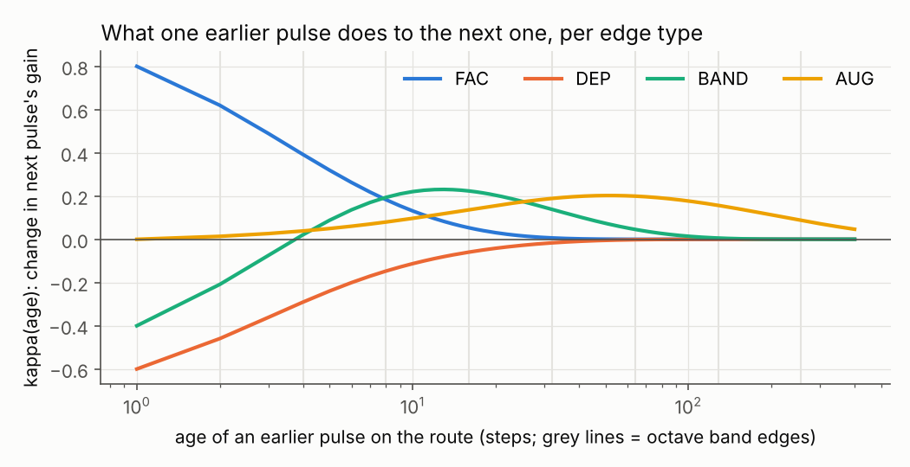
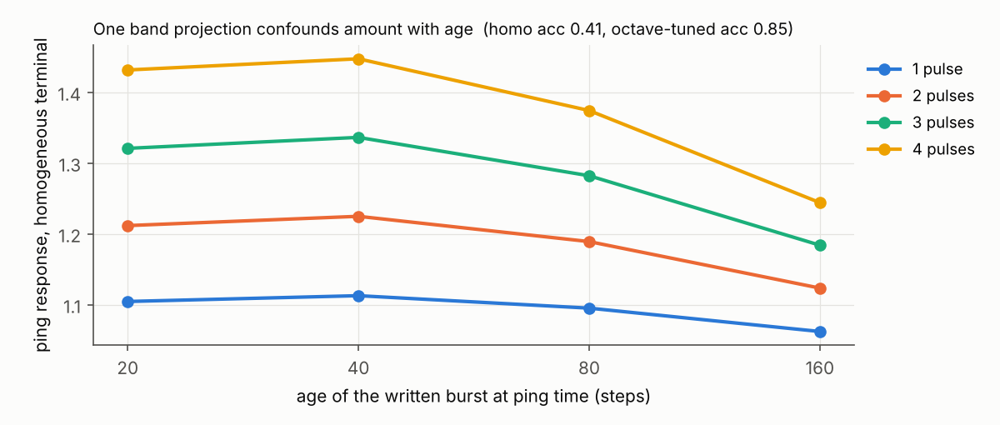
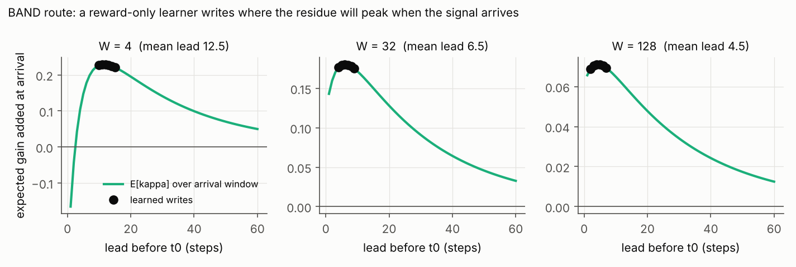
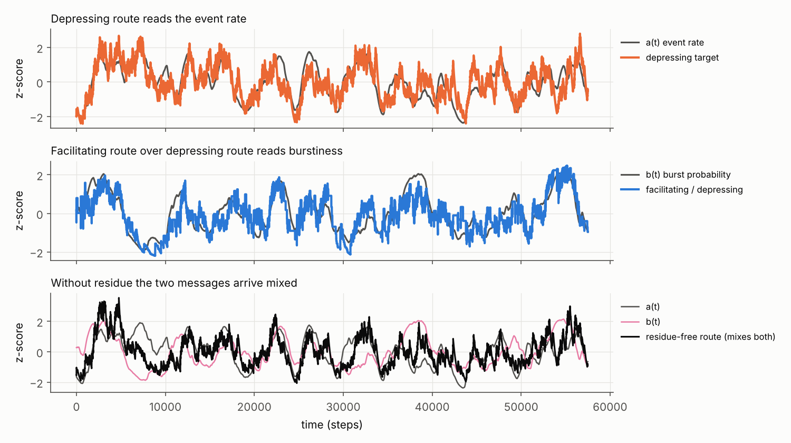

# BrahClaude — routes that keep a Sihti residue of their own pulses

**Question (Nov 3 2026):** what if the pulse travelling along a route carries the
route's *residue* of earlier pulses, Sihti-style, and each new pulse adds to it?
Then a neuron pinging the network reads (and writes) the hidden state *on the
routes*, not just on the neurons.

This repo builds the smallest version of that and tests it with gates that were
pre-registered before any run ([PREREGISTRATION.md](PREREGISTRATION.md), commit
`1bcba05`). Plain numpy, CPU, ~25 s: `python run_all.py`, tests: `pytest tests`.

## The edge

Each route keeps K=8 exponential traces of the pulses that crossed it,
`m_k(t+1) = λ_k m_k(t) + x(t)`, `τ_k = 2, 4, …, 256` steps. Its Sihti residue
stack is the octave-age bins of its own history,

```
h_0 = m_0,   h_k = m_k − m_{k−1}      Σ_k h_k = m_{K−1}   (exact telescoping)
```

and a pulse leaving the route is

```
y(t) = x(t) · max(0, 1 + g·h(t))
```

The spike itself is stereotyped (0/1). What it *carries out* is decided by the
route's band gains `g` and the residue earlier pulses left there. Unclipped, this is
exactly a second-order Volterra system,
`y = x(t)[1 + Σ_s κ(s) x(t−s)]`, `κ(s) = Σ_k (g_k − g_{k+1}) λ_k^{s−1}`, so the band
basis is a sum-of-exponentials kernel written as an octave residue stack.



Four route types: **FAC** (facilitating), **DEP** (depressing), **BAND** (depress
then facilitate, peak at age 13), **AUG** (slow augmentation, peak at age 52).
These are rough stand-ins for real short-term plasticity at its separated
timescales (facilitation, depression, augmentation, post-tetanic potentiation).

## Results (as pre-registered)

| Gate | What | Result |
|---|---|---|
| G0a | telescoping Σh = m_{K−1} | **PASS** (err 3.6e-15) |
| G0b | edge == explicit Volterra kernel | **PASS** (err 5.3e-15) |
| G0c | first pulse on a fresh route returns exactly 1 for every type | **PASS** — reading a route requires a prior write |
| G1 | identify hidden route type by probing (6 pulses, σ=0.3) | **FAIL** — optimised 0.994 vs best fixed (burst) 0.947: +0.047, threshold was +0.05 |
| G2a | silent memory read by a neutral ping | **PASS** — 0.996 accuracy; delay output exactly 0; reset control 0.125 (chance) |
| G2b | amount vs age from one ping | **PASS** — octave-tuned terminals 0.85, homogeneous 0.41 |
| G3a | reward-only learner writes on the right route | **PASS** — FAC: 100 % on target; DEP: 100 % on the *other* route |
| G3b | learned write timing tracks the residue peak | **PASS** — BAND lead 12.5 at W=4 (κ peak 13), falls to 4.5 at W=128 |
| G3c | learner ≥ 95 % of greedy | **PASS** — all six cases within 0.1 % |
| G4 | two messages down one axon, separated by the routes | **FAIL** — corr(â, a) 0.757 < 0.8; every other criterion passed |

### G1 — probing a route (fail, narrowly)

The learner's train is `[8, 9, 10, 11, 12, 20]`: a short burst (separates FAC from
DEP from the rest) and then one pulse ~8–12 steps later, aimed at the age where
BAND's residue peaks and AUG's has barely started. Error rate falls from 5.3 % (best
fixed train) to 0.6 %, a ninefold reduction, but the accuracy gain is +0.047 and I
pre-registered +0.05. Fail as written; the margin was a ceiling effect I did not
anticipate (the burst train is already strong).

### G2 — silent memory, and why the octave stack matters

G2a is the Wolff et al. (2017) "ping" shape: a burst written by someone else on 2 of
8 routes, 150 silent steps (output exactly zero; nothing for a passive observer to
see), then one neutral pulse on all routes reads which routes were written with
99.6 % accuracy. Resetting the residues to their mean kills it (12.5 %, chance).

G2b is the Sihti-specific part. One band projection cannot tell "4 pulses long ago"
from "2 pulses recently":



Four terminals of one axon tuned to different octave bands read different projections
of the residue stack, and one ping then decodes both **how much** and **when** (16
classes, 0.85 vs 0.41).

### G3 — writing residue for a later pulse

A pinger places 6 pulses before t0; a third party's spike then arrives on both routes
somewhere in a window W. The learner is rewarded only for what that later spike
delivers. It finds, without a model:

- FAC routes: prime the target route. DEP routes: prime the *other* route to block it.
- Timing: lead ≈ κ-peak − W/2 (BAND: 12.5 → 6.5 → 4.5; AUG at W=32: 37.7 vs 52 − 16 = 36).



**Honest caveat:** because the history is linear before the clip, the optimal policy
is a matched filter (put pulses at the top slots of E[κ] on the sign-matched route),
and the learner simply finds that. It shows that reward-only learning discovers
write-for-later; it does not show anything a matched filter would not.

### G4 — burst multiplexing (fail on a threshold above the noise ceiling)

One spike train carries two independent slow signals: event rate a(t) and burst
probability b(t). A depressing target and a facilitating target on the same axon
separate them: the depressing readout tracks the event rate, and
facilitating/depressing tracks burstiness (corr 0.82). Cross-talk −0.07 and −0.02.
A residue-free route mixes both (corr 0.64 with a, 0.40 with b), and with flat routes
the ratio is identically 1, carrying no b-information at all.



corr(â, a) is 0.757, below the pre-registered 0.8. The diagnostic shows why: an ideal
counter of the true event onsets reaches only 0.757 against a(t) (Poisson shot noise
at this readout timescale), and the depressing route matches that ideal counter at
0.9996. The route did its job; my threshold sat above the information ceiling. FAIL
as written.

Two bugs were fixed after G4's first run, both disclosed: the low-pass filter ran
along the wrong array axis (all correlations ≈ 0), and the flat control used
`F/(D+1e-6)`, which made an identical-route ratio spuriously non-constant.

## Prior art (none of the mechanisms here is new)

- Short-term plasticity as edge state: Tsodyks & Markram 1997; Abbott et al. 1997.
- The probe Δr = r_B − r_A is the **paired-pulse ratio**, a standard electrophysiology tool.
- Silent synaptic working memory: Mongillo, Barak & Tsodyks 2008.
- Pinging to read hidden state: Wolff, Jochim, Akyürek & Stokes 2017.
- Burst multiplexing read by facilitating vs depressing synapses: Naud & Sprekeler 2018.
- Bank of exponentials as a history code: Shankar & Howard 2012 (Laplace-transform time cells).

What this repo adds is small and specific: the route history written as an exact Sihti
residue stack (octave age bins), and the measurement that octave-tuned terminals let
one ping separate **amount** from **age** (G2b) where a single projection cannot.

## Open

- Nonlinear writes (resource depletion à la Tsodyks–Markram) would make G3 more than a
  matched filter — writes would interact, and spreading vs stacking pulses would matter.
- The chessboard pinger (homeostatic coupler) learning probe trains online across a
  whole graph of residue routes, rather than one route at a time.
